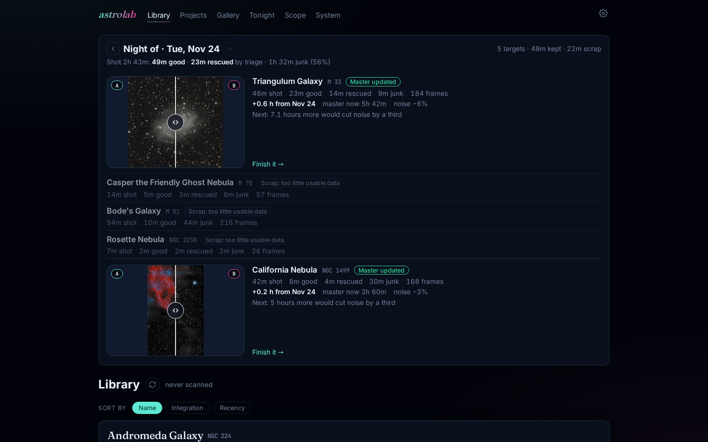
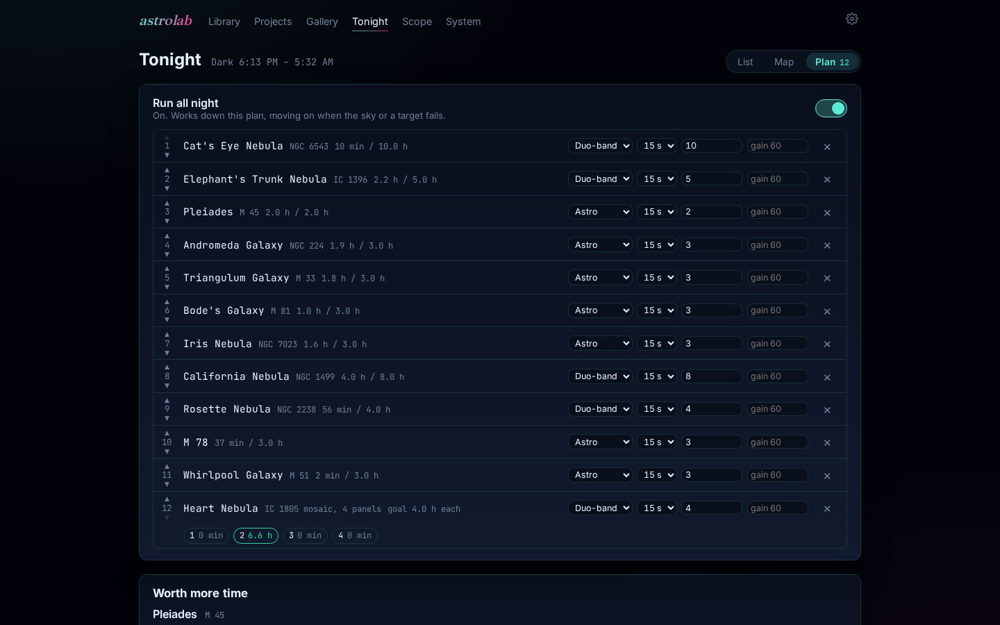
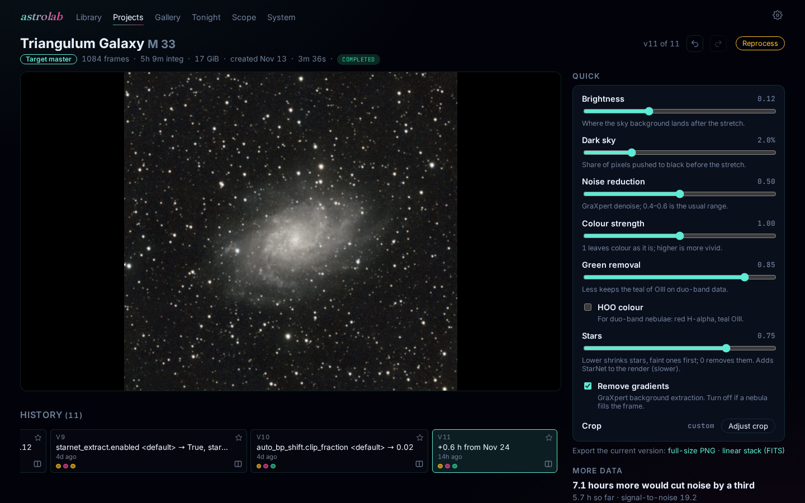

<p align="center">
  
</p>

<p align="center">
  <em>The scope shoots all night, the stacks are waiting in the morning, and the finishing is yours.</em>
</p>

---

## What it is

astrolab is a self-hosted astrophotography workbench for a smart telescope that lives outside. It has three parts:

- **Capture.** A scheduler runs the scope all night from a plan you set on the **Tonight** page. It moves on when clouds roll in or a target fails, and learns which parts of the sky your house and trees block.
- **Library.** Overnight, new frames are copied in, judged, calibrated and stacked. Every target keeps a master that grows with each good night.
- **Finishing.** In the morning you open a target and make the picture with a few big sliders. Every change is kept, so you can go back, compare, and export.

The motto from the [roadmap](docs/roadmap.md): automate the chores, keep the craft. The machine sorts frames and stacks them. Making the picture stays with you, and the app does not edit pictures with AI.

Today the capture side drives a **DWARF 3** through a small relay service. The library and finishing sides also take FITS files from other capture programs (see [Other scopes](#other-scopes)).



## Capture: the scope runs itself


- **Tonight** lists what is up and well placed, with a sky map you can pan to find a target and send the scope to it.
- **The plan** is an ordered list of targets, each with a filter, exposure, gain and an hours goal. Time from earlier nights counts toward the goal.
- **Run all night** works down the plan. It prepares and calibrates the scope, slews, captures, and closes the barrel when the night ends. While it waits on clouds it probes the sky with short captures, and it stops a capture that stalls.
- **Mosaics.** A target too big for one frame gets panels. Panels are shot in turn and stacked together.
- **The learned sky.** Each frame the scope could not register stars in marks a patch of sky as suspect. Patches that keep failing over several nights get skipped. A wide-camera panorama of the surroundings can draw the skyline from the start.
- **Alerts** go to a webhook (ntfy works) when something needs you, including rain or snow in the forecast while the scope is open.




## Library: stacking happens overnight

- New sessions are copied from the scope (and, optionally, to a NAS).
- Frames are triaged into good, rescued (frames the scope called failed that pass a second look) and junk. Scrap sessions are cleaned up.
- Each night is calibrated with matching darks, flats and bias, plate solved against a local Gaia catalogue (star matching is the fallback), registered and stacked with **Siril**.
- **Target masters** combine every kept night of a target. Sessions are grouped by where they land on the sky, not by name, so mosaic panels and a target saved under two names merge.
- The home page shows last night: what was shot, what was kept, and how much more time would cut the noise by a third. That estimate feeds back into the plan.

## Finishing: you make the picture



- **Quick** sliders for brightness, dark sky, noise reduction, colour strength, green removal and stars, plus HOO colour for duo-band data and a crop on the picture.
- **GraXpert** removes gradients and noise; **StarNet++** shrinks or removes stars.
- Every render is a revision in the history strip: undo, branch, compare two side by side, and publish keepers to the gallery.
- Export a full-size PNG or the linear stack as FITS for another tool.
- Underneath is a pipeline of cached nodes. Changing a finishing slider never re-runs calibration or stacking, so edits come back in seconds.

## Quick start

### Docker (recommended)

The image bundles Siril and GraXpert. New to Docker? [INSTALLING.md](INSTALLING.md) walks through it.

**CPU only:**

```bash
docker run -d \
  --name astrolab \
  -p 8000:8000 \
  -v ~/Pictures/Siril:/captures \
  -v astrolab-data:/data \
  ghcr.io/bscholer/astrolab:latest
```

**NVIDIA GPU** (much faster GraXpert and StarNet++; needs the [NVIDIA Container Toolkit](https://docs.nvidia.com/datacenter/cloud-native/container-toolkit/install-guide.html)):

```bash
docker run -d \
  --name astrolab \
  --gpus all \
  -p 8000:8000 \
  -v ~/Pictures/Siril:/captures \
  -v astrolab-data:/data \
  -e ASTROLAB_ENABLE_STARNET=1 \
  ghcr.io/bscholer/astrolab:cuda
```

`ASTROLAB_ENABLE_STARNET=1` downloads StarNet++ v2 into `/data` on first run. Leave it out if you don't need star removal.

Open `http://localhost:8000`. astrolab scans `/captures` on first run, so existing sessions show up within seconds.

| Path | Purpose |
|------|---------|
| `/captures` | Your capture tree. Read-only (`:ro`) is fine if you only process files; with a scope connected, astrolab copies new sessions here, so it must be writable. |
| `/data` | Settings, the catalog, projects, the cache, and the optional StarNet++ binary. |

### Connecting a scope

1. Run the relay: [dwarf3-control](https://github.com/bscholer/dwarf3-control) (a Docker image) or the [Home Assistant app](https://github.com/bscholer/home-assistant-dwarf3). It talks to the DWARF 3 and leaves room for the DWARFLAB app on the same connection.
2. In astrolab's **Settings**, set your site's latitude and longitude, and the scope service URL (the relay, port 9902).
3. Add targets on **Tonight**, then turn on **Run all night**.

astrolab talks to the relay over a small versioned HTTP API, routed by the service's own OpenAPI file, and shows only the features the service lists. Another scope can be supported by writing a service that follows the same spec. No astrolab changes are needed.

### Try it without a scope

`server/fakescope/` is a pretend DWARF 3 with a synthetic yard and weather. It serves the relay API (`python -m server.fakescope`, port 9902), so you can point astrolab at it and watch the scheduler work. It can also run the real scheduler through many simulated nights in seconds, which is how scheduler and sky-map changes get tested.

### From source

```bash
git clone https://github.com/bscholer/astrolab.git
cd astrolab
uv sync --extra dev
cd ui && npm ci && cd ..

.venv/bin/uvicorn server.api:app --reload --host 0.0.0.0 --port 8000   # API on :8000
cd ui && npm run dev                                                   # UI on :5173
```

Siril, GraXpert and StarNet++ must be installed on the host for the processing paths. [CONTRIBUTING.md](CONTRIBUTING.md) covers tests, lint and adding pipeline nodes.

## Other scopes

Ingest reads FITS headers, not folder layouts. NINA, ZWO ASIAIR and Seestar captures are recognised and sorted into sessions, and adding another capture program is usually one `if` in the classifier ([Adding a scope](CONTRIBUTING.md#adding-a-scope)). Processing has been validated end to end on DWARF 3 data. Scope control needs a scope service, which today exists for the DWARF 3.

## For tools and agents

Every endpoint is in the OpenAPI spec ([docs/openapi.json](docs/openapi.json)). astrolab serves an MCP endpoint at `/mcp` with a few tools so far ([docs/mcp-tools.json](docs/mcp-tools.json)). The relay has its own MCP server for driving the scope directly. Prometheus metrics are at `/metrics`, and OpenTelemetry traces are sent when `OTEL_EXPORTER_OTLP_ENDPOINT` is set.

## Hardware and OS

The Docker image is amd64 and runs anywhere Docker does: Linux, macOS through Docker Desktop, and Windows through WSL2.

- **CPU only** (`:latest`, `:cpu`): everything works; GraXpert and StarNet++ are slow.
- **NVIDIA GPU** (`:cuda`): tested on Ampere and Ada.
- **Apple Silicon**: the image runs under Rosetta. Siril and stacking work, but GraXpert and StarNet++ crash at startup under emulation. Use a Linux or amd64 host for full pipelines.

## Status

v1. It runs a DWARF 3 every clear night and processes the results. Settings and the API are stable enough to build on; the [V1.1](https://github.com/bscholer/astrolab/milestone/2) and [V2](https://github.com/bscholer/astrolab/milestone/3) milestones track what's next.

## Built on

The image processing is done by tools astrolab runs as separate processes:

- **[Siril](https://siril.org)** (GPLv3): calibration, registration, stacking, plate solving.
- **[GraXpert](https://www.graxpert.com)** (GPLv3): gradient removal and denoise.
- **[StarNet++ v2](https://www.starnetastro.com)** (proprietary freeware): star removal.

The stacking steps follow the shape of [Naztronomy's smart-telescope script](https://github.com/naztronaut/siril-scripts/blob/main/Naztronomy-Smart_Telescope_PP.py); no code is copied. The multi-scope header classifier and filter aliases were derived clean-room from public header dumps in [starbash](https://github.com/geeksville/starbash) (Kevin Hester). The relay's DWARF message definitions come from [dwarf_python_api](https://github.com/stevejcl/dwarf_python_api) (Steve JC), which the relay uses as a dependency. Full notes are in [LICENSES/THIRD_PARTY.md](LICENSES/THIRD_PARTY.md).

## Links

- [Roadmap](docs/roadmap.md): where it's going and why.
- [Design doc](docs/design.md): pipeline contracts, cache shape, node authoring.
- [Contributing](CONTRIBUTING.md): dev setup, tests, adding a node or a scope.
- [Issues](https://github.com/bscholer/astrolab/issues).

## License

MIT, with a CC BY-SA 4.0 carve-out for the vendored OpenNGC catalog under `catalogs/openngc/` (Mattia Verga). See [LICENSE](LICENSE).

Tonight thumbnails come from the Digitized Sky Survey (STScI/NASA), coloured and tiled by CDS and hosted by ESA ESASky. The server downloads them on demand and does not bundle them. See the [DSS copyright terms](https://archive.stsci.edu/dss/copyright.html).

The Docker image bundles Siril (GPLv3) and GraXpert (GPLv3) as separate programs; astrolab's MIT license covers only astrolab's own source. See [LICENSES/THIRD_PARTY.md](LICENSES/THIRD_PARTY.md).
