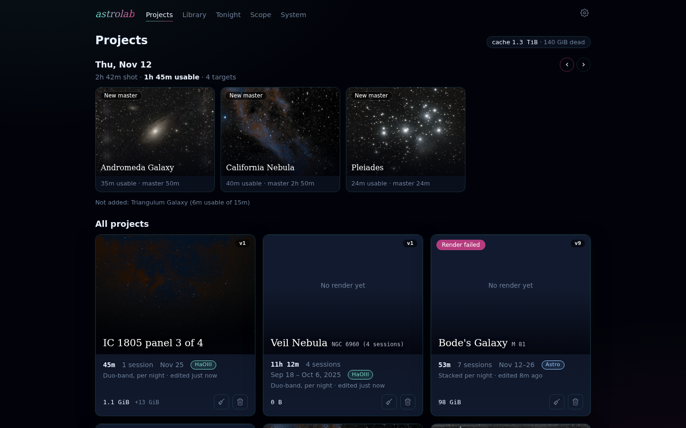
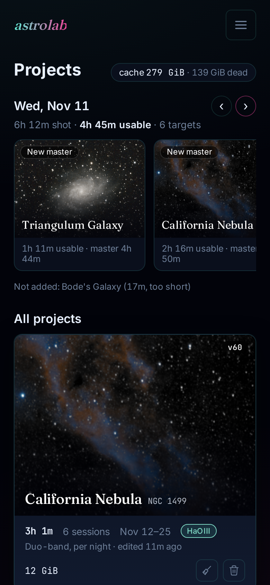
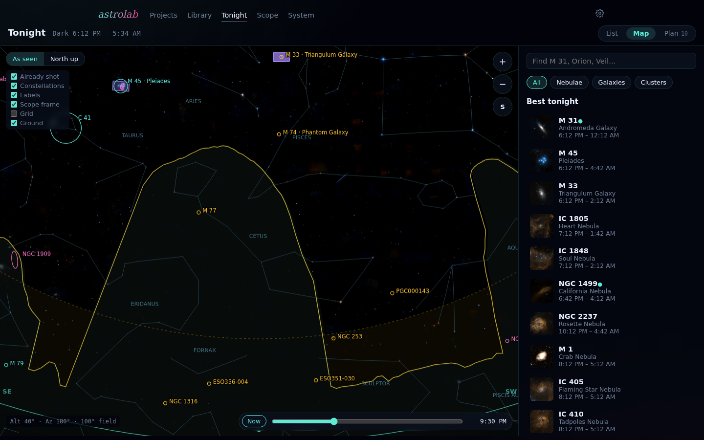
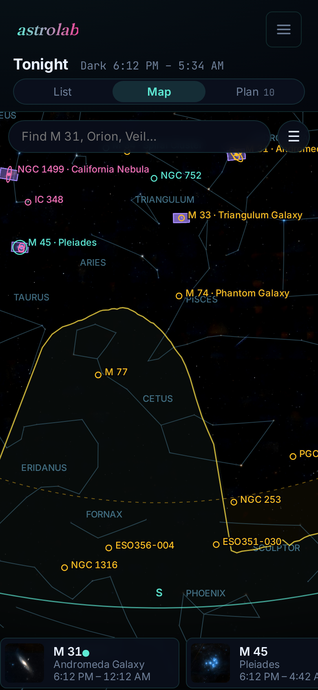
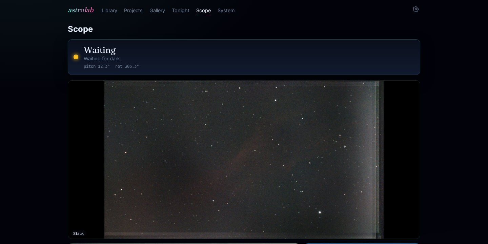
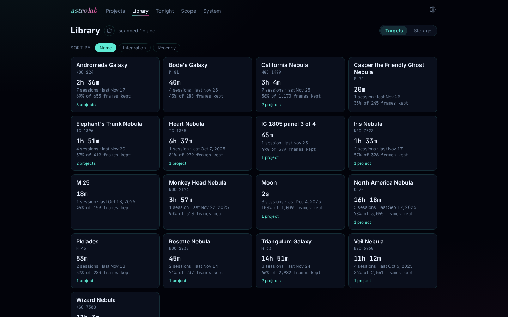
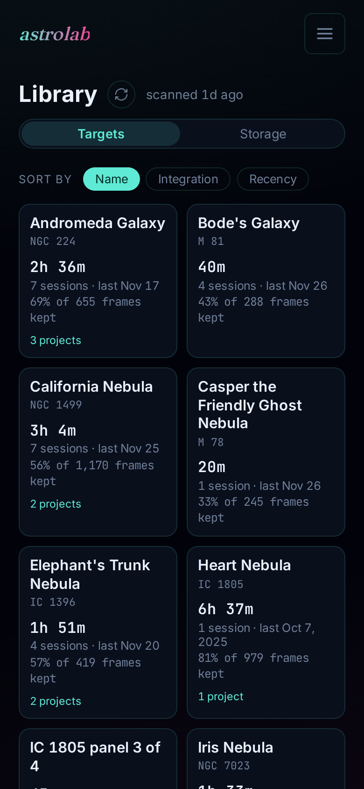
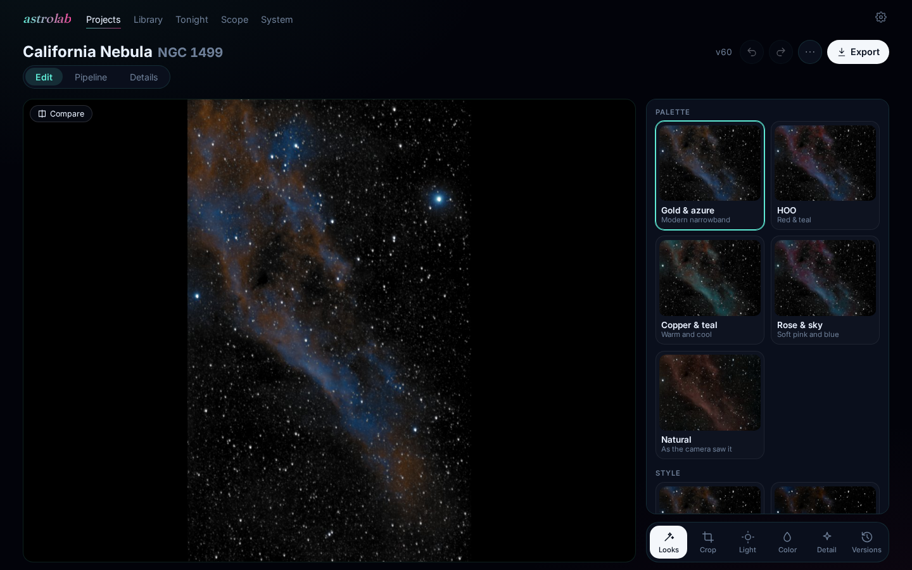
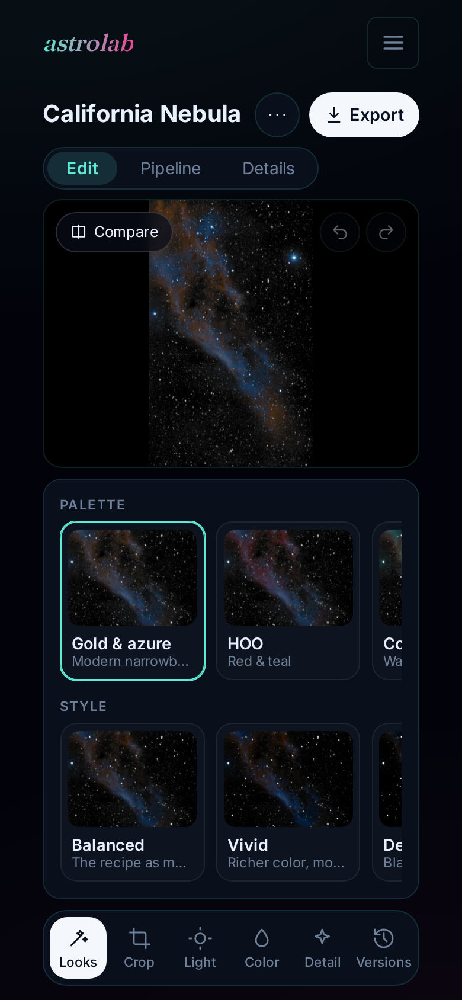

<p align="center">
  
</p>

<p align="center">
  <em>Scheduling, stacking and processing for a smart telescope.</em>
</p>

---

astrolab is a self-hosted web app I use to run a DWARF 3 that sits outside on a fence. At night it picks targets and drives the scope. During the night and the next morning it copies the frames over, throws out the bad ones, and stacks them. Then I open a target and process it in the browser.

The scope connection goes through a small relay service ([dwarf-relay](https://github.com/bscholer/dwarf-relay)), so the DWARF 3 is the only scope it can control right now. Processing works on FITS files from other capture programs too (see [Other scopes](#other-scopes)).

<p>
  
  
</p>

## Capture

<p>
  
  
</p>

The Tonight page lists what's up and well placed, and has a sky map you can pan around to find a target and point the scope at it.

You build a plan there: an ordered list of targets, each with a filter, exposure, gain and a goal in hours. Time from earlier nights counts toward the goal. With "Run all night" on, the scheduler works down the list. It prepares and calibrates the scope, slews, captures, and closes the barrel when it gets light. When it's cloudy it takes short test captures until the sky clears, and it gives up on a capture that stalls.

Other things it handles:

- Mosaics. Targets too big for one frame are split into panels that get shot in turn and stacked together.
- Trees and houses. When the scope can't find stars in a frame, that bit of sky gets marked. If it keeps failing over several nights, the scheduler stops pointing there. You can also scan the surroundings with the wide camera to get the skyline up front.
- Alerts. It can post to a webhook (ntfy works) when something needs attention, including rain or snow in the forecast while the scope is out.




## Library

New sessions get copied off the scope. Frames are sorted into good, rescued and junk. "Rescued" means the scope marked the frame as failed but it looks fine on a second check. Sessions with too little usable data are deleted.

With a NAS folder set in Settings, the NAS keeps the reference copy of every kept session, every finished picture and FITS, and a daily database snapshot. The server's disk then works like a cache in front of it. When the disk runs short, astrolab first clears pipeline steps it can rebuild, then moves raw frames from nights older than a week to the NAS (only after checking every file arrived intact). A job that needs those frames copies them back before it starts, which is slow, so the heavy stacking is best left to the overnight runs. Every version's picture, and the stacked and final FITS of each project's first, latest and cover versions, always stay on the server, so editing a project never waits on the NAS. Without a NAS, everything stays local.

Each night is calibrated with matching darks, flats and bias, plate solved against a local Gaia catalogue (falling back to star matching), registered and stacked with Siril. The nights for a target are then combined into a master, which gets rebuilt whenever a good night is added. Sessions are matched by sky position, so mosaic panels end up in the same master, and so does a target that was saved under two different names.

The Projects page opens with how last night went: what each target added to its master. Each master's Details tab estimates how many more hours it would take to cut the noise by a third, and that estimate goes back into the plan.

<p>
  
  
</p>

The Library page has a tile per target with its total time and how many frames were kept. A tile opens the target's sessions, where you can start a new project from any of them. The Storage tab has two charts: what's taking up the server's disk (raw captures, kept results, the pipeline cache, other files, and free space) and what's on the NAS.

## Processing

<p>
  
  
</p>

Each project opens in an editor with six tools: Looks, Crop, Light, Color, Detail and Versions. Looks are one-tap starting points, each shown on your own picture. Duo-band data gets color palettes (HOO, gold and azure, and a few more), and every target gets styles like Vivid or Faint detail. The other tools have a few sliders each: brightness, background, contrast, highlights and shadows; H-alpha and OIII colors and saturation; stars, sharpening and noise reduction. GraXpert handles gradient removal and denoising, and StarNet++ shrinks or removes stars.

Most sliders update the picture right away. A preview is rendered on the server from the stack as you drag, and the full-size render follows when you stop. Edits made in one sitting are saved as one version. Versions lets you go back, branch, and compare two of them, and the Compare button shows before and after side by side. You can export a full-size PNG, or the linear stack as FITS if you'd rather finish somewhere else.

Under the hood it's a pipeline of cached steps, so the full render after an edit doesn't redo calibration or stacking. Most come back in a few seconds; a crop takes longer, since every step after it runs again.

I don't want the app editing pictures with AI, so it doesn't. The [roadmap](docs/roadmap.md) has more on where this is going.

## Quick start

### Docker (recommended)

The image bundles Siril and GraXpert. New to Docker? [INSTALLING.md](INSTALLING.md) walks through it.

**CPU only:**

```bash
docker run -d \
  --name astrolab \
  -p 8000:8000 \
  -v ~/Pictures/Siril:/captures \
  -v astrolab-data:/data \
  ghcr.io/bscholer/astrolab:latest
```

**NVIDIA GPU** (much faster GraXpert and StarNet++; needs the [NVIDIA Container Toolkit](https://docs.nvidia.com/datacenter/cloud-native/container-toolkit/install-guide.html)):

```bash
docker run -d \
  --name astrolab \
  --gpus all \
  -p 8000:8000 \
  -v ~/Pictures/Siril:/captures \
  -v astrolab-data:/data \
  -e ASTROLAB_ENABLE_STARNET=1 \
  ghcr.io/bscholer/astrolab:cuda
```

`ASTROLAB_ENABLE_STARNET=1` downloads StarNet++ v2 into `/data` on first run. Leave it out if you don't need star removal.

Open `http://localhost:8000`. astrolab scans `/captures` on first run, so existing sessions show up within seconds.

| Path | Purpose |
|------|---------|
| `/captures` | Your capture tree. Read-only (`:ro`) is fine if you only process files; with a scope connected, astrolab copies new sessions here, so it must be writable. |
| `/data` | Settings, the catalog, projects, the cache, and the optional StarNet++ binary. |

### Connecting a scope

1. Run the relay: [dwarf-relay](https://github.com/bscholer/dwarf-relay) (a Docker image) or the [Home Assistant app](https://github.com/bscholer/home-assistant-dwarf). It talks to the scope, and you can still use the DWARFLAB app at the same time.
2. In astrolab's **Settings**, set your site's latitude and longitude, and the scope service URL (the relay, port 9902).
3. Add targets on **Tonight**, then turn on **Run all night**.

astrolab talks to the relay over a small versioned HTTP API and only shows the features the relay says it supports. To add another scope, you'd write a service with the same API; astrolab itself wouldn't need to change.

### Try it without a scope

`server/fakescope/` is a fake DWARF 3 with a made-up yard and weather. It serves the same API as the relay (`python -m server.fakescope`, port 9902), so you can point astrolab at it and watch the scheduler go. It can also run the real scheduler through lots of simulated nights in a few seconds, which is how I test scheduler changes.

### From source

```bash
git clone https://github.com/bscholer/astrolab.git
cd astrolab
uv sync --extra dev
cd ui && npm ci && cd ..

.venv/bin/uvicorn server.api:app --reload --host 0.0.0.0 --port 8000   # API on :8000
cd ui && npm run dev                                                   # UI on :5173
```

Siril, GraXpert and StarNet++ must be installed on the host for the processing paths. [CONTRIBUTING.md](CONTRIBUTING.md) covers tests, lint and adding pipeline nodes.

## Other scopes

astrolab works out where files came from by reading their FITS headers, so folder layout doesn't matter. It recognises captures from NINA, ZWO ASIAIR and Seestar, and adding another capture program is usually a few lines in the classifier ([Adding a scope](CONTRIBUTING.md#adding-a-scope)). I've only tested processing end to end on DWARF 3 data, though, and scope control is DWARF 3 only for now.

## API

Every endpoint is in the OpenAPI spec ([docs/openapi.json](docs/openapi.json)). astrolab serves an MCP endpoint at `/mcp` with a few tools so far ([docs/mcp-tools.json](docs/mcp-tools.json)). The relay has its own MCP server for driving the scope directly. Prometheus metrics are at `/metrics`, and OpenTelemetry traces are sent when `OTEL_EXPORTER_OTLP_ENDPOINT` is set.

## Hardware and OS

The Docker image is amd64 and runs anywhere Docker does: Linux, macOS through Docker Desktop, and Windows through WSL2.

- **CPU only** (`:latest`, `:cpu`): everything works; GraXpert and StarNet++ are slow.
- **NVIDIA GPU** (`:cuda`): tested on Ampere and Ada.
- **Apple Silicon**: the image runs under Rosetta. Siril and stacking work, but GraXpert and StarNet++ crash at startup under emulation. Use a Linux or amd64 host for full pipelines.

## Status

v0.3. I use it every clear night, but settings and the API can still change between releases. The [milestones](https://github.com/bscholer/astrolab/milestones) track what's next.

## Built on

The image processing is done by tools astrolab runs as separate processes:

- **[Siril](https://siril.org)** (GPLv3): calibration, registration, stacking, plate solving.
- **[GraXpert](https://www.graxpert.com)** (GPLv3): gradient removal and denoise.
- **[StarNet++ v2](https://www.starnetastro.com)** (proprietary freeware): star removal.

The stacking steps follow the shape of [Naztronomy's smart-telescope script](https://github.com/naztronaut/siril-scripts/blob/main/Naztronomy-Smart_Telescope_PP.py); no code is copied. The multi-scope header classifier and filter aliases were derived clean-room from public header dumps in [starbash](https://github.com/geeksville/starbash) (Kevin Hester). The relay's DWARF message definitions come from [dwarf_python_api](https://github.com/stevejcl/dwarf_python_api) (Steve JC), which the relay uses as a dependency. Full notes are in [LICENSES/THIRD_PARTY.md](LICENSES/THIRD_PARTY.md).

## Links

- [Roadmap](docs/roadmap.md): where it's going and why.
- [Design doc](docs/design.md): pipeline contracts, cache shape, node authoring.
- [Contributing](CONTRIBUTING.md): dev setup, tests, adding a node or a scope.
- [Issues](https://github.com/bscholer/astrolab/issues).

## License

MIT, with a CC BY-SA 4.0 carve-out for the vendored OpenNGC catalog under `catalogs/openngc/` (Mattia Verga). See [LICENSE](LICENSE).

Tonight thumbnails come from the Digitized Sky Survey (STScI/NASA), colored and tiled by CDS and hosted by ESA ESASky. The server downloads them on demand and does not bundle them. See the [DSS copyright terms](https://archive.stsci.edu/dss/copyright.html).

The Docker image bundles Siril (GPLv3) and GraXpert (GPLv3) as separate programs; astrolab's MIT license covers only astrolab's own source. See [LICENSES/THIRD_PARTY.md](LICENSES/THIRD_PARTY.md).
